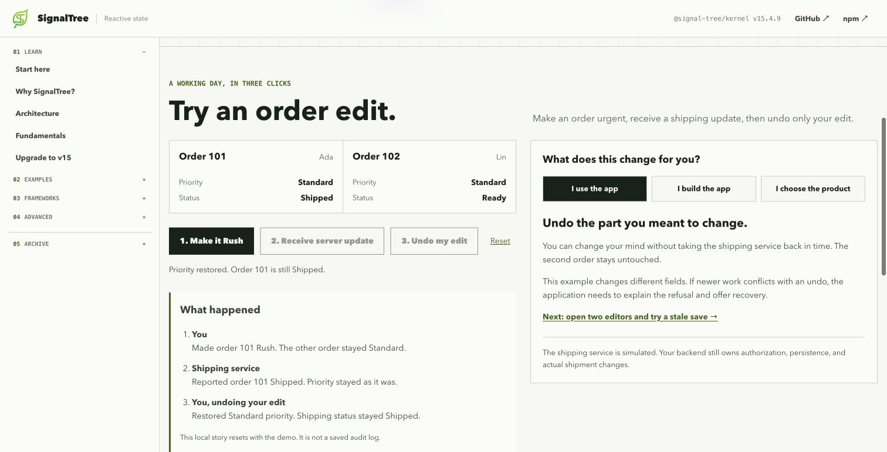

# 15.4.9 publication and verification

The owner authorized builds, pushes, publication and a provisional v16 test
release on November 18, 2026. This phase selects 15.4.9; stable v15 uses
`latest`, while the v16 prerelease uses `rc` and must not replace `latest`.
All five packages are now published and registry-verified. The signed release
source is `2ab7e24540e97b1afc29b084a73c95b7a9f83107`; this report is a later
documentation-only successor. The production demo is Ready from that source;
publication and hosted verification are complete.

## Published artifact verification

The [exact-tag Linux run](https://github.com/JBorgia/signal-tree/actions/runs/44337013757)
passes all 91 normal gates and all 91 mutation proofs, followed by a clean
uncached rebuild and fresh installed consumers. The
[canonical publication run](https://github.com/JBorgia/signal-tree/actions/runs/44341276111)
also passes its full qualification, including the publisher's separate sealed
normal/mutation/rebuild sequence. The
[GitHub release](https://github.com/JBorgia/signal-tree/releases/tag/v15.4.9)
uses the signed tag. No workflow ran from a different source ref for publication.

[Publication receipts](PUBLICATION-RECEIPTS.json) preserve raw CI logs, the CI
candidate journal, downloaded registry metadata/attestations and the generating
verification script. All five downloaded registry archives are byte-identical to
the CI archives, with matching SHA512 integrity and SHA1 metadata. Every package's
`latest` channel is 15.4.9. `npm audit signatures` cryptographically verifies all
five registry signatures and all five attestations with no missing or invalid
entries. The attested source, tag, workflow and invocation match the release.

A fresh registry installation resolves all five packages. Strict consumers pass
under bundler and node16 resolution; the actual published Angular and kernel
archives pass a production Angular AOT/browser consumer. These are fresh
published-artifact checks, not a relabeling of the earlier local checks below.

The preview deployment from the frozen commit is Ready. Its hosted Undo story
restores an order's Standard priority while retaining the server's Shipped status
and leaving the other order unchanged. The separate production build is Ready at
[signaltree.io](https://signaltree.io/), deployment
`EA4NSjgz5y53yxh7PX9jsGiMUqpb`, also from the frozen release commit. The published
site displays 15.4.9 and passes the same hosted interaction. These manual journeys
use the simulated shipment service, not a live shipping backend. The complete
local strict demo suite passed 179 checks with retries disabled; that broader
suite and the hosted checks are distinct evidence.

Independent closure rehashed the five registry/CI archives, checked all 158
installed files against their archives and inspected raw provenance subjects.
It found no demonstrated publication blocker. A separate packaging pass verified
all 38 publication receipts against their originals, reviewed the hosted proof
and found no exposed credentials or unrelated private work. Those reviews are
read-only integrity/source checks; they do not substitute for executed consumers
or claim to have independently operated the hosted demo.

## Accepted cost policy

The prior startup/economics controller accepted a specific candidate while
retaining failing historical numeric ceilings. This phase explicitly supersedes
that disposition for this release line with a deliberate, measured budget
baseline. It does not turn the historical runs into passes. The original
[qualification and costs](../2026-11-18-startup-economics/README.md) remain intact.
The user directed that cost and feasibility be weighed and authorized releases.
Independent premise and interpretation reviews found the memory/correctness
benefits sufficient to support this policy, subject to the checks below.

Only previously failing fixture rows may change: v15 entity production and
development, or v16 bare/entity production and development. Fresh finalized
version measurements determine minimal rounded headroom. Workload, externals,
production defines and measurement behavior remain unchanged. No generic
allow-failure path is added. Growth/restoration controls must return 0/1/0.
Wrong artifacts are rejected by source/event/tag identity and build seals, not
inferred from equal compressed size.

## Artifact continuity and release path

The runtime qualification source is `e45fd69616586cae6f7f9e8622c082199d0fded0`. Fresh JavaScript and declaration
payloads must match that source's preserved candidate; versioned manifests,
guidance and demos have separate release validation. Earlier timings and heap
findings remain historical observations, not reruns on renamed artifacts.

Publication uses the same exact-tag publisher on both lines. Every normal gate
must preserve a sealed fresh build; mutation checks run separately; an uncached
post-mutation build must match the original seal before packing. Archive hashes
are checked again around registry operations. The supported pinned Playwright
container is shared by release CI. Full diagnostics have a bounded 20 MiB gate
buffer to avoid the previously observed Node default-buffer truncation.

## Qualification scope

- Fresh package bytes, old-ceiling results, chosen ceilings and growth controls.
- Publisher wrong-input, wrong-artifact and tamper controls.
- Full normal and mutation gates, exact restoration and fresh installed consumers.
- Production demo, focused changed interactions and full route/browser checks.
- Independent release closure, signed tag and exact-tag Linux qualification.
- Five registry archives matching publication journal, channel verification,
  provenance/signatures and fresh registry consumer checks.
- Successful deployments and hosted journeys, with stable and prerelease channels
  clearly distinguished.

## Fresh budget baseline

Production/development gzip bytes come from the fresh production package build
and `node tools/check-bundle-budget.mjs`. The output now prints integer bytes
alongside the existing rounded KiB; measurement behavior is unchanged.

| Fixture | Prod bytes | Dev bytes | Old prod/dev KiB | New prod/dev KiB |
| --- | ---: | ---: | --- | --- |
| bare | 11,048 | 13,197 | 10.80 / 12.90 | 10.80 / 12.90 |
| entities | 25,368 | 28,311 | 24.70 / 27.50 | 24.78 / 27.65 |

The old gate still returned exit 1. Only the stated ceilings change, leaving
less than 10.24 bytes of rounding headroom in each raised row. Fresh growth
controls and final-artifact qualification subsequently passed as recorded below.

## Completed local qualification

[Receipt index](RECEIPTS.json) binds the commands, logs and SHA256 hashes. Raw
logs are losslessly gzipped; both stored and decompressed hashes are recorded,
so terminal color escapes are preserved without entering tracked text. These
are working-tree checks before the final release commit; exact-tag CI is still
required. All 91 normal gates pass. All 91 mutation proofs pass (15 indirect),
with zero unproven, vacuous, blind or errored results. All 1,788 captured source
files restore byte-for-byte; independent review rehashed that snapshot and
confirmed coverage of every tracked file.

After deleting generated output, the uncached production build passes. Fresh
installed export resolution, strict types under bundler and node16, and a real
production Angular AOT/browser consumer pass. The strict production demo builds
and all 179 browser checks pass with retries disabled. The budget control is
normal passing / planted growth rejected / restored fresh build passing (0/1/0).
Publisher controls pass 46/46, including wrong identity, token/prebuilt bypass,
artifact drift, rebuild mismatch and tarball tampering.

Every one of the 133 shipped JavaScript/declaration payloads matches the
integrity-verified frozen runtime archives. The first attempted continuity scan
incorrectly included four generated adapter declaration stubs excluded by the
package manifests; the corrected check selects actual `npm pack --dry-run --json`
files. No runtime mismatch was found. An initial publisher-control port also
included fourteen v16-only callable-cleanup controls whose helper does not exist
on v15. That first failure is preserved; the unrelated section was removed,
while all 46 actual publication controls remain and pass.

Independent source/security review found two release-tooling gaps during
preparation: the unrelated helper dependency above and missing fresh strict
consumer/AOT checks in the GitHub-release workflow. Both are corrected. Review
finds no further demonstrated source blocker; it does not replace CI or registry
verification. This was the precommit local closure; the signed-tag CI and registry
evidence above subsequently completed. The original local receipts retain their
prepublication scope.
